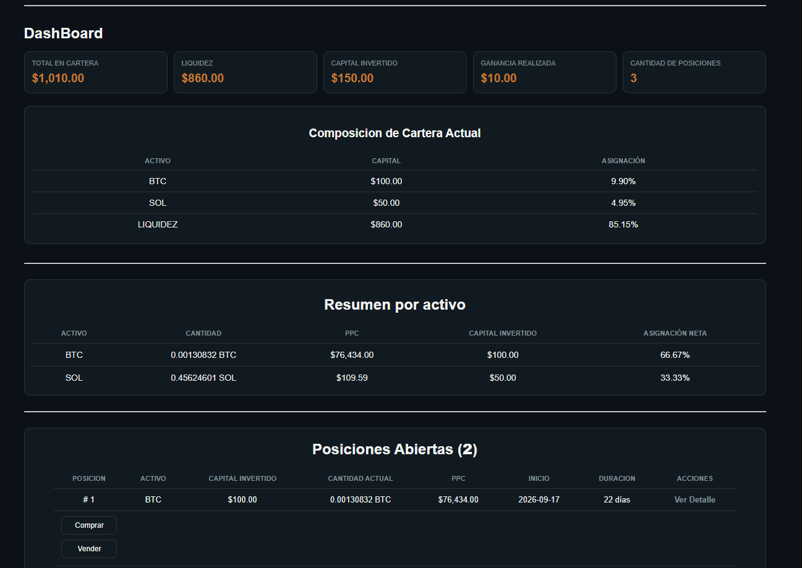
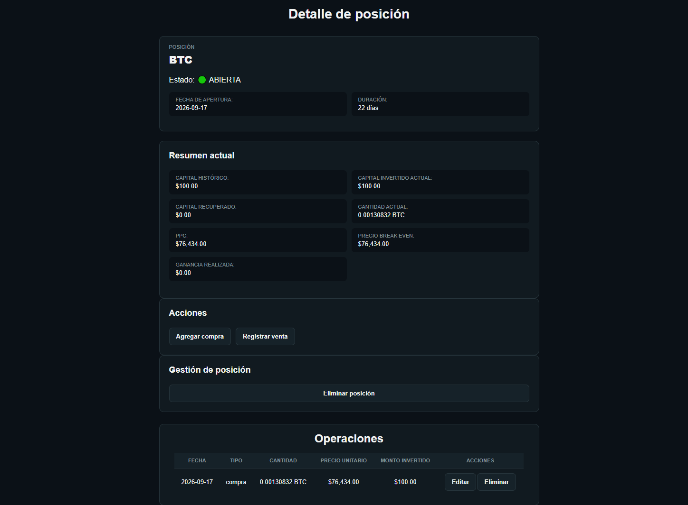
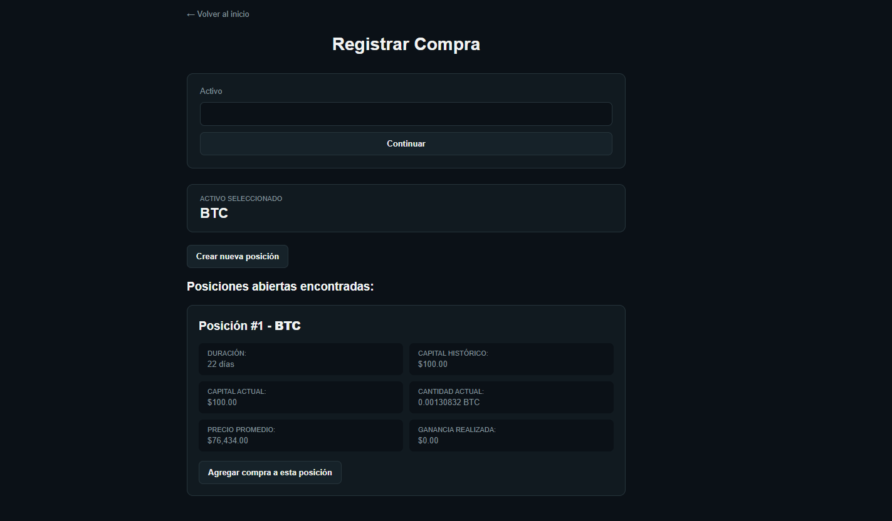

# 📊 Cartera de Activos

Aplicación web para la gestión y análisis de una cartera de inversiones, desarrollada con Python y Flask mediante una arquitectura modular basada en separación de responsabilidades.

El proyecto nació como una herramienta personal para registrar y analizar operaciones de inversión y evolucionó progresivamente desde una aplicación de consola con persistencia en JSON hasta una aplicación web con persistencia en SQLite.

El foco del proyecto no es únicamente el resultado final, sino también el aprendizaje progresivo de conceptos como:

- Modularización.
- Separación de responsabilidades.
- Lógica de negocio.
- Persistencia de datos.
- Validaciones.
- Diseño de una arquitectura escalable.
- Desarrollo web con Flask.
- Manejo de bases de datos con SQLite.
- Control de versiones con Git.

---

## 🎯 Objetivo

Desarrollar una plataforma web para la gestión y análisis de una cartera de inversiones personales.

La aplicación busca ofrecer una visión completa de la cartera mediante indicadores, resúmenes por activo, seguimiento de posiciones y operaciones históricas, permitiendo registrar, editar y eliminar operaciones de compra y venta de activos financieros desde una interfaz web intuitiva.

El proyecto tiene como objetivo principal aplicar buenas prácticas de desarrollo de software mediante una arquitectura modular, separación de responsabilidades, validación de datos y persistencia estructurada en una base de datos SQLite.

El objetivo es continuar evolucionando la aplicación mediante mejoras en su arquitectura, experiencia de usuario, persistencia y seguridad, incorporando progresivamente nuevas funcionalidades y tecnologías.

---

## ⭐ Características principales

- Arquitectura modular.
- Aplicación web desarrollada con Flask.
- Persistencia de datos mediante SQLite
- Gestión de múltiples posiciones por activo.
- Gestión de posiciones abiertas y cerradas.
- Registro, edición y eliminación de operaciones.
- Dashboard con métricas generales.
- Configuración del capital inicial.
- Cálculos financieros automáticos.
- Cálculo de precio de break-even.
- Cálculo de asignación de capital por activo.
- Resúmenes por activo y por posición.
- Historial de posiciones cerradas.
- Historial completo de operaciones.
- Filtros para consultar operaciones.

---

## 🚀 Estado actual del proyecto

🚧 En desarrollo activo.

La aplicación web se encuentra funcional y cuenta con persistencia de datos mediante SQLite. Actualmente permite gestionar operaciones de compra y venta, administrar posiciones abiertas y cerradas, consultar métricas financieras y mantener los cambios guardados entre reinicios de la aplicación.

El proyecto también funciona como una herramienta de uso personal y como entorno de aprendizaje para seguir incorporando conocimientos de desarrollo web, arquitectura de software y bases de datos.

### Próxima etapa

- Desplegar la aplicación para acceder desde distintos dispositivos mediante un enlace.
- Garantizar la persistencia y la seguridad de los datos en el entorno desplegado.
- Incorporar autenticación de usuarios como etapa posterior.
- Continuar mejorando la interfaz y evaluar futuras integraciones con APIs financieras.

---

## 🏗️ Arquitectura actual

### Flujo general de la aplicación

```
                USUARIO 
                   │ 
                   ▼ 
              INTERFAZ WEB 
              Flask + Jinja2 
                   │ 
                   ▼ 
        ROUTES (rutas / controladores Flask) 
                   │ 
                   ▼ 
        SERVICIOS (reglas de negocio) 
                   │ 
    ┌──────────────┼──────────────┐ 
    ▼              ▼              ▼ 
    VALIDACIONES OPERACIONES POSICIONES 
    │              │              │ 
    └──────────────┼──────────────┘ 
                   ▼ 
        CÁLCULOS (análisis y resúmenes) 
                   │ 
                   ▼ 
             PERSISTENCIA 
                   │ 
                   ▼ 
                SQLite 
                   │ 
                   ▼ 
             database.db
```

### Responsabilidad de los módulos

El proyecto está dividido por responsabilidades:

- routes/ → recibe las solicitudes HTTP y conecta la interfaz web con los servicios de la aplicación.
- servicios.py → contiene la lógica de negocio y coordina las operaciones entre los diferentes módulos.
- validaciones.py → contiene las validaciones necesarias para mantener la consistencia de los datos.
- operaciones.py → gestiona la creación, edición, eliminación y consulta de operaciones.
- posiciones.py → gestiona la creación, apertura, cierre, reapertura y eliminación de posiciones.
- calculos.py → realiza análisis financieros, cálculos y generación de resúmenes.
- persistencia.py → gestiona la lectura y escritura de los datos en SQLite.
- database.py → administra la conexión y configuración de la base de datos SQLite.
- utilidades.py → contiene funciones auxiliares reutilizadas por diferentes módulos.
- templates/ → contiene las interfaces HTML renderizadas mediante Jinja2.
- static/ → contiene los recursos estáticos de la aplicación, como CSS y JavaScript.

---

## 🛠️ Tecnologías utilizadas 

- Python
- Flask
- HTML
- CSS
- JavaScript
- Jinja2
- SQLite
- SQL
- JSON (utilizada en una etapa anterior)
- Git
- GitHub

## 🚀 Tecnologías planificadas

- APIs financieras
- Visualización avanzada de datos

---

## 🧠 Ejemplo de flujo de una operación

Por ejemplo, al registrar una compra:

Usuario
   ↓
Formulario web
   ↓
routes/compras.py
   ↓
servicios.py
   ↓
validaciones.py
   ↓
posiciones.py / operaciones.py
   ↓
calculos.py
   ↓
persistencia.py
   ↓
SQLite

Este flujo permite mantener separadas las responsabilidades de cada componente y facilita la evolución de la aplicación.

### Ejemplo

Al registrar una compra de BTC:

Activo: BTC
Monto invertido: $250
Precio de compra: $73,206.82
Cantidad calculada: 0.00341498 BTC

La aplicación valida los datos, registra la operación dentro de una posición y persiste la información en SQLite.

Cuando posteriormente se registra una venta, la aplicación actualiza la posición, recalcula sus métricas y determina si la posición continúa abierta o pasa a estado cerrado.

---

## 🖥️ Capturas de pantalla

### Dashboard


### Detalle de una posición


### Gestión de operaciones


---

## 📚 Conceptos aplicados

Durante el desarrollo de este proyecto se aplican conceptos como:

- Separación de responsabilidades.
- Programación modular.
- Validación de datos.
- Persistencia de información.
- Arquitectura escalable.
- Refactorización continua.
- Control de versiones con Git.

---

## 👨‍💻 Autor

Leandro Floridia

Proyecto personal desarrollado como parte de mi proceso de aprendizaje en:

- Programación en Python
- Arquitectura de Software
- Desarrollo web
- Ciencia de datos aplicada a finanzas
- Git y GitHub

El objetivo del proyecto es evolucionar progresivamente desde una aplicación de consola hasta una aplicación web completa, aplicando buenas prácticas de programación y diseño de software durante todo el proceso.

---